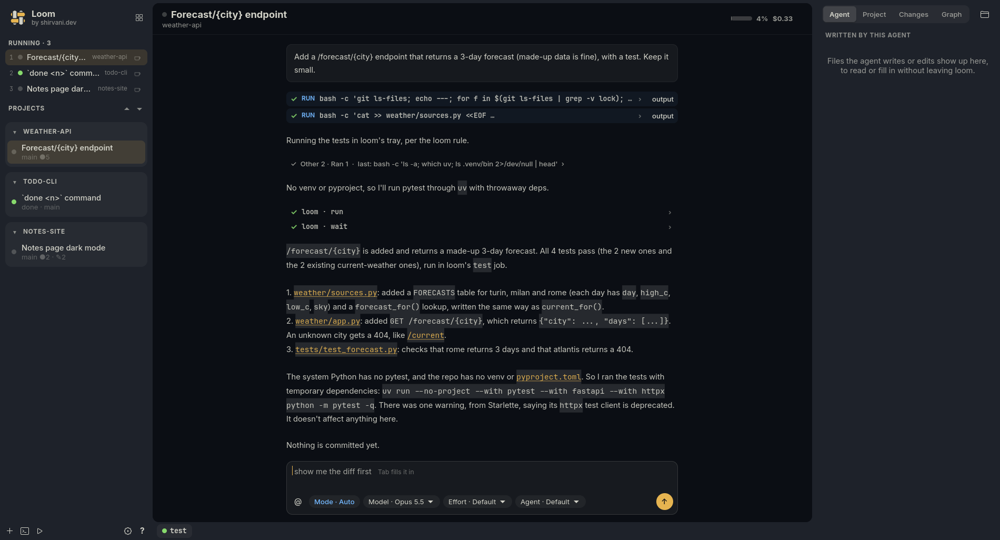
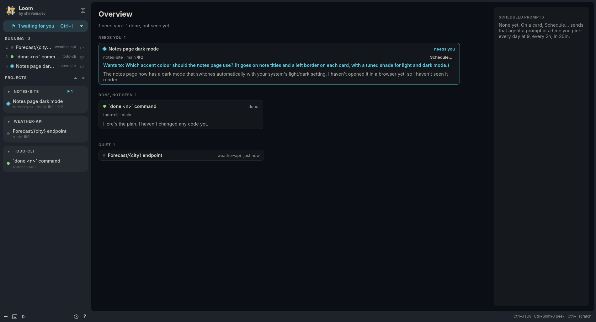
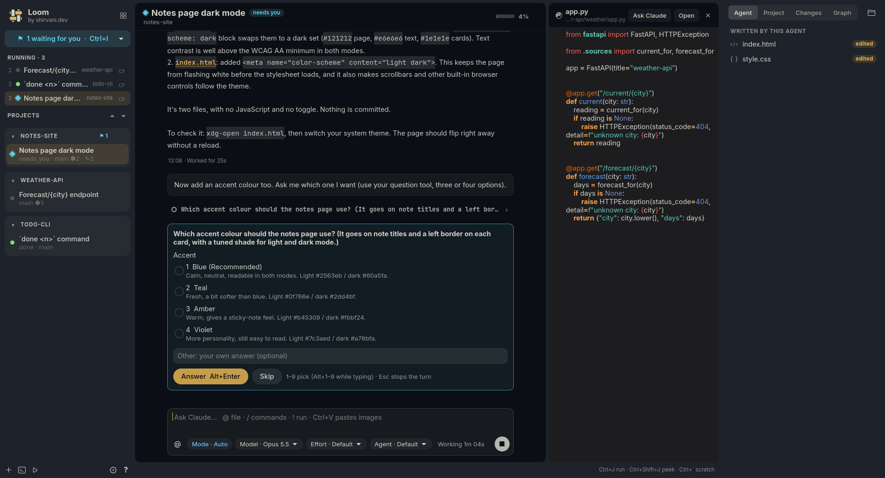

# loom

A light, keyboard-first home for coding agents, written in Rust with GTK 4.

Each agent is a Claude Code session driven over [ACP](https://agentclientprotocol.com)
(`claude-agent-acp`) and shown as a chat, not a terminal. Agents are grouped by project, and
a project may hold several git repos.

| | |
|---|---|
|  |  |

## Features

- **Agents first.** Many at once, each with a status (working, needs you, done, idle).
  Idle agents are suspended to save memory and wake when you open them.
- **A sidebar of projects**, with a Running list above them. Agents can be dragged into any
  order, and a cup keeps one awake. Ctrl+Tab can cycle through the running agents only.
- **An overview** of every agent, sorted by what needs you, with the scheduled prompts beside it.
- **A real chat.** Markdown and code blocks, tool cards, subagents, and pasted images.
  Queue messages while Claude works, or steer the running turn with Ctrl+Enter.
  Claude's questions and permission requests are answered from the keyboard.
- **Suggestions.** loom guesses your next message, and Tab fills it in.
- **A job tray.** Commands Claude runs for a long time (dev servers, tests, builds) appear
  there as named jobs. `!command` in the chat runs a command and hands its output to Claude.
- **Files.** A project tree and an editor, with images shown, a git graph, and drag and drop.
- **A scratch terminal**, one key away (Ctrl+\`).
- **Schedules.** Run a prompt at a time or on a repeat ("weekdays 9:30", "every 2h").
- **Add-ons**, each off until you switch it on in Settings → Add-ons:
  - **Notes.** Keeps what you tell your agents in a vault of notes, by topic. The vault opens
    in Obsidian too.
  - **Telegram.** Your agents in a Telegram bot of your own: it relays their replies and takes
    your messages, voice, photos and answers. It talks only to the one account you link.
  - **Speech to text.** Talk instead of typing, through any OpenAI-style transcription
    endpoint you set: Groq, OpenAI, or a local Whisper server.
- **Themes** follow your GTK colours. Persian and right-to-left text work.

## Agents know about loom

Agents get loom's own MCP server (`loom mcp`). Through it they run long commands as jobs in
the tray, wait on them, read their output, and open files for you. The `loom` skill tells
Claude Code when to use these tools.

loom has its own Claude folder, `~/.config/loom/claude`: skills, agents, commands and hooks
that only loom's agents load (`claude` in a terminal doesn't). Settings → Claude lists them,
switches them on and off, and opens them in loom's editor.

## Install

loom runs on Linux and needs:

- GTK 4.14 or later, GtkSourceView 5 and VTE (gtk4)
- Node and npm, for the ACP adapter
- Claude Code, logged in (loom uses your login)

On Arch: `pacman -S gtk4 gtksourceview5 vte4 nodejs npm`. On Ubuntu 24.04 or Debian 13:
`apt install libgtk-4-1 libgtksourceview-5-0 libvte-2.91-gtk4-0 nodejs npm`.

### From a release

Download `loom-<version>-x86_64-linux.tar.gz` from
[Releases](https://github.com/Soheil7799/loom/releases), unpack it and run `./install.sh` in
it. It is built on Ubuntu 24.04, so it runs there and on anything newer (Debian 13, Fedora 40,
Arch…).

### From source

With Rust installed, run `./install.sh` in a checkout; it builds loom first (with six jobs; set
`JOBS=` for a different number).

### What it installs

- `loom` into `~/.local/bin`, with a desktop entry and an icon;
- the ACP adapter into `~/.local/share/loom/adapter`;

## Use

Start loom from your app launcher or with `loom`. Open a project folder with Ctrl+Shift+N,
then start an agent in it with Ctrl+N.

| Keys | |
|---|---|
| Ctrl+Shift+P | Show Command Palette |
| Ctrl+/ | All the keyboard shortcuts |
| Ctrl+N | New agent, or resume a past conversation |
| Ctrl+K | Go to an agent |
| Ctrl+1…9 | An agent by its place |
| Ctrl+Tab | Next agent |
| Ctrl+E / Ctrl+P | Files panel / find a file |
| Ctrl+J | Run a command in the tray |
| Ctrl+\` | Scratch terminal |
| Ctrl+, | Settings |

Ctrl+B followed by a letter works as in herdr (V split, J/K next/previous, C new agent…).

Settings are kept in `~/.config/loom`.

## License

MIT
